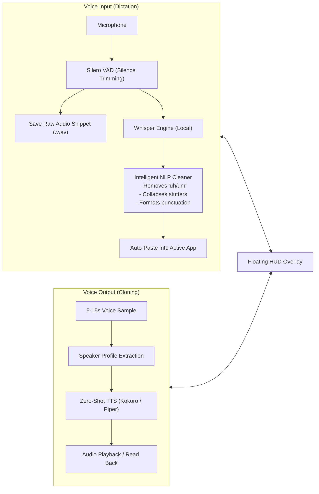

<div align="center">
  <h1>⚡ OpenFlow</h1>
  <h3>The Open-Source, Local-First Voice OS</h3>
  <p><strong>Intelligent Wispr Flow dictation + Zero-shot voice cloning. 100% offline on your device.</strong></p>

  <p>
    <a href="#quick-start"></a>
    <a href="LICENSE"></a>
    <a href="#privacy"></a>
    <a href="#presets"></a>
  </p>

  <p>
    <a href="#features">Features</a> •
    <a href="#quick-start">Quick Start</a> •
    <a href="#architecture">Architecture</a> •
    <a href="#model-presets">Model Presets</a> •
    <a href="#roadmap">Roadmap</a>
  </p>

  <p><sub>
    <strong>English</strong> • <a href="docs/README_CN.md">简体中文</a> • <a href="docs/README_JA.md">日本語</a> • <a href="docs/README_DE.md">Deutsch</a> • <a href="docs/README_ES.md">Español</a>
  </sub></p>
</div>

---

## 🌟 Why OpenFlow?

Paid subscriptions like **Wispr Flow** ($15/mo) and **ElevenLabs** ($30/mo) charge continuous fees and send your private microphone recordings and sensitive documents to third-party cloud servers.

**OpenFlow replaces both tools with one lightweight, local-first desktop application:**
1. **Intelligent Dictation (Voice-IN)**: Hold a global hotkey anywhere (`Ctrl+Space` / `Fn`), speak naturally, and get cleaned, punctuated, stutter-free text typed directly into whichever application you are using.
2. **Zero-Shot Voice Cloning (Voice-OUT)**: Record a 5–15 second audio sample once. OpenFlow synthesizes speech in your own voice offline.
3. **Dual Recording Preservation**: Saves timestamped raw `.wav` audio snippets alongside intelligent transcriptions so you never lose your original thoughts.

---

## 🚀 Comparison Matrix

| Feature | Wispr Flow | ElevenLabs | **OpenFlow** |
| :--- | :---: | :---: | :---: |
| **Price** | $15 / month | $5 - $330 / month | **Free & Open Source** |
| **Privacy** | Cloud uploads | Cloud uploads | **100% Local & Offline** |
| **Intelligent Dictation** | ✅ | ❌ | **✅ Built-in** |
| **Voice Cloning & TTS** | ❌ | ✅ | **✅ Built-in** |
| **Filler Word Removal** | ✅ | ❌ | **✅ Built-in ("uh", "um", "like")** |
| **Spoken Punctuation** | ✅ | ❌ | **✅ Built-in ("comma", "new line")** |
| **Preserves Raw Audio** | ❌ | ❌ | **✅ Timestamped .wav archive** |
| **Floating Dynamic Pill HUD** | ✅ | ❌ | **✅ Glassmorphic Waveform** |

---

## 🧠 Architecture



---

## ⚡ Model Presets

OpenFlow provides 3 performance tiers to run optimally on any hardware:

| Preset | STT Model | TTS / Cloning | Latency | Target Machine |
| :--- | :--- | :--- | :--- | :--- |
| ⚡ **Fast** | Whisper Tiny / Base | Piper TTS | `<150ms` | Any laptop / CPU |
| ⚖️ **Balanced** | Whisper Small (q5) | Kokoro-82M | `<400ms` | Apple Silicon / 8GB RAM |
| 💎 **Pro Studio** | Whisper Large-v3 Turbo | F5-TTS / Zero-Shot | High fidelity | High-end GPU / 16GB+ Mac |

---

## 🛠️ Quick Start

### Prerequisites
- Node.js 18+ & npm
- Python 3.10+ (for local AI engine)

### Run OpenFlow Locally

```bash
# 1. Clone repository
git clone https://github.com/your-username/openflow.git
cd openflow

# 2. Install dependencies
npm install

# 3. Start local engine daemon
npm run engine &

# 4. Start OpenFlow Studio & Floating HUD
npm run dev
```

---

## 📁 Repository Structure

```
openflow/
├── engine/                       # Python AI & Audio Processing Pipeline
│   ├── dictation_cleaner.py      # Intelligent deterministic cleanup engine
│   ├── voice_cloner.py           # Zero-shot speaker profile & TTS engine
│   ├── models_manager.py         # Fast / Balanced / Pro tier manager
│   ├── history_manager.py        # Dual archive: raw .wav + clean text
│   └── server.py                 # Local IPC HTTP daemon (localhost:18488)
├── src-tauri/                    # Rust Desktop Shell
│   ├── src/main.rs               # Background daemon & global hotkeys
│   ├── Cargo.toml                # Rust dependencies
│   └── tauri.conf.json           # Native window & tray configuration
├── src/                          # Modern React + Tailwind Frontend
│   ├── components/
│   │   ├── FloatingPill.tsx      # Wispr Flow style Dynamic Island HUD
│   │   └── StudioDashboard.tsx   # Full audio workstation & settings
│   ├── App.tsx                   # Main container
│   └── index.css                 # Glassmorphic UI & waveform animations
├── package.json
└── vite.config.ts
```

---

## 🔒 Privacy & Local-First Guarantee

- **Zero Cloud Calls**: No audio data or transcripts ever leave your local machine.
- **Zero API Keys Required**: All models run locally on your CPU or GPU.
- **Your Data Stays Yours**: Recordings and voice profiles are stored in `~/.openflow/`.

---

## 📄 License

OpenFlow is open-source software licensed under the [MIT License](LICENSE).
