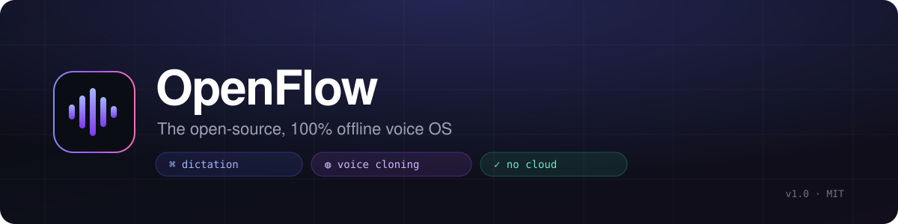
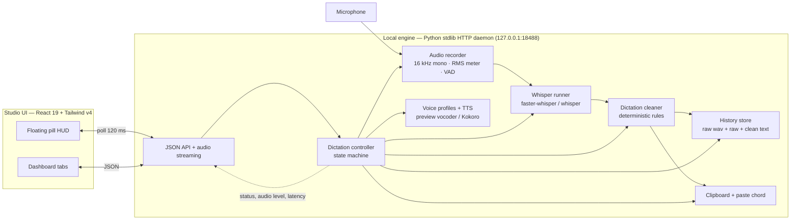
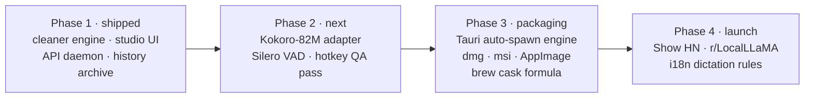

<div align="center">
  

  <h3>Intelligent dictation + zero-shot voice cloning. One local app. No cloud.</h3>

  <p>
    <a href="LICENSE"></a>
    <a href="#quick-start"></a>
    <a href="#privacy"></a>
    <a href="#tests"></a>
    <a href="#roadmap"></a>
  </p>

  <p>
    <a href="#quick-start">Quick start</a> •
    <a href="#what-works-today">What works</a> •
    <a href="#architecture">Architecture</a> •
    <a href="#model-tiers">Model tiers</a> •
    <a href="#api">API</a> •
    <a href="#roadmap">Roadmap</a>
  </p>

  <p><sub>
    <strong>English</strong> •
    <a href="docs/README_CN.md">简体中文</a> •
    <a href="docs/README_JA.md">日本語</a> •
    <a href="docs/README_DE.md">Deutsch</a> •
    <a href="docs/README_ES.md">Español</a>
  </sub></p>
</div>

---

## Why OpenFlow?

Cloud dictation and voice-cloning tools charge a monthly fee **and** ship your microphone
stream to someone else's GPU. OpenFlow replaces both workflows with one program that runs
entirely on your machine:

| | Wispr Flow | ElevenLabs | Speechify | **OpenFlow** |
| :--- | :---: | :---: | :---: | :---: |
| Price | $15/mo | $5–330/mo | $20/mo | **Free, MIT** |
| Your audio | uploaded | uploaded | uploaded | **stays on disk** |
| Intelligent dictation | ✅ | ❌ | ❌ | **✅** |
| Zero-shot voice cloning | ❌ | ✅ | ❌ | **✅** |
| Removes "uh/um" and stutters | ✅ | ❌ | ❌ | **✅** |
| Spoken punctuation ("comma") | ✅ | ❌ | ❌ | **✅** |
| Keeps the raw `.wav` | ❌ | ❌ | ❌ | **✅** |
| Works offline | ❌ | ❌ | ❌ | **✅** |
| Accounts, API keys, telemetry | required | required | required | **none** |

**Net saving for a developer: about $65/month, and the audio never leaves the laptop.**

---

## Quick start

Requirements: **Node.js 18+** and **Python 3.10+**. No accounts, no API keys, no models to
download before the first launch.

```bash
git clone https://github.com/yashjaiswal2818/openflow.git
cd openflow

npm install     # Studio dependencies
npm run dev     # starts the local engine (:18488) and the Studio (:1420)
```

Open **http://localhost:1420**.

The engine boots in **demo mode** when no microphone or Whisper runtime is present, so the
full pipeline is explorable immediately: a simulated capture is recorded, transcribed,
cleaned by the real rule engine, archived with a real WAV and rendered in the history.

### Turn on real speech (optional)

```bash
pip install -r requirements.txt   # faster-whisper, sounddevice, pynput, kokoro-onnx…
npm run dev
```

OpenFlow detects each dependency at runtime and shows exactly what is active under
**Settings → Diagnostics**. Nothing else to configure.

### Run the pieces separately

```bash
npm run engine     # Python engine only  (python3 -m engine.server)
npm run dev:web    # Studio only          (Vite, proxies /api to the engine)
npm run build      # type-check + production bundle
npm test           # TypeScript type-check + 62 engine tests
```

---

## What works today

Honesty matters more than a feature checklist, so this table reflects the current code:

| Capability | Status | Notes |
| :--- | :--- | :--- |
| Deterministic dictation cleaner | ✅ **Complete** | Fillers, stutters, spoken punctuation, casing, acronyms. 20 unit tests, <1 ms, idempotent. |
| Dual recording preservation | ✅ **Complete** | Raw WAV + raw transcript + cleaned transcript, searchable and exportable. |
| Voice profiles | ✅ **Complete** | Browser capture → 16 kHz WAV → validation (duration/loudness/clipping) → pitch analysis. |
| Offline synthesis | ✅ **Works (preview quality)** | Built-in formant vocoder follows your pitch and the text rhythm. Neural backends are auto-detected when installed. |
| Global hotkey + auto-paste | ✅ **Implemented** | Needs `pynput` and a clipboard tool (`pbcopy` / `clip` / `wl-copy` / `xclip`). Verified at the code/API level. |
| Energy VAD + silence trimming | ✅ **Complete** | Silero VAD is not wired yet; energy VAD is used instead. |
| Whisper transcription | ✅ **Implemented** | `faster-whisper` first, then `openai-whisper`. Not installed in CI, hence demo mode. |
| Kokoro-82M / Piper TTS | ⏳ **Adapter pending** | Backend probing exists; model loading is the next milestone. |
| Tauri desktop shell | ⏳ **Scaffold** | Window/tray config and Rust entry point exist; it does not spawn the engine yet. |
| Silero VAD | ⏳ **Planned** | Energy VAD ships today. |
| Multi-language dictation | ⏳ **Planned** | Cleaner rules are English-only for now. |

> **Demo mode** is never silent about itself: the Studio shows a persistent badge, every API
> result carries `demo: true`, and the engine logs why real capture is unavailable.

---

## Architecture



**Design decisions**

- **The cleaner is deterministic, not a model.** No sampling, no drift, no GPU, identical
  output on every platform — and fast enough to run on every keystroke-sized transcript.
- **The engine is standard-library Python.** `numpy`, `sounddevice`, `pynput` and Whisper are
  optional extras, so the daemon always starts and always tells you what is missing.
- **The browser never talks to `localhost` directly.** The Studio uses relative `/api` paths
  and Vite proxies them, which keeps one origin, no CORS, and works behind a preview proxy.

---

## Model tiers

| Tier | Speech-to-text | TTS / cloning | Target latency | RAM | Machine |
| :--- | :--- | :--- | :--- | :--- | :--- |
| ⚡ **Fast** | `tiny.en` · q5_1 | Piper VITS | `<150 ms` | `<500 MB` | any laptop, CPU only |
| ⚖️ **Balanced** | `small.en` · q5_k | Kokoro-82M | `<350 ms` | `~1.5 GB` | Apple Silicon / 8 GB |
| 💎 **Pro Studio** | `large-v3-turbo` | F5-TTS zero-shot | high fidelity | `~4 GB` | RTX GPU / 16 GB Mac |

Switching tiers releases the previous Whisper model before loading the next one, so memory
does not creep. The tier is stored in `~/.openflow/config.json` and applied on next inference.

---

## The cleaner, concretely

```text
raw   : uh basically i think that the the openflow engine is super fast
        comma new line ready for production period
clean : I think that the OpenFlow engine is super fast,
        Ready for production.
```

| Rule | Example |
| :--- | :--- |
| Filler removal | `uh`, `um`, `erm`, "you know", "basically", hesitation "like" |
| Stutter collapse | `the the` → `the`, `I I` → `I`, `th-the` → `the` |
| Rhetorical emphasis kept | `no, no, no!` and `very, very good` are preserved |
| Spoken punctuation | `comma` `period` `question mark` `exclamation point` `colon` `semicolon` |
| Structure | `new line` → `\n`, `new paragraph` → `\n\n` |
| Casing | sentence starts, pronoun `I`/`I'm` |
| Tech vocabulary | `api` → `API`, `json` → `JSON`, `openflow` → `OpenFlow`, `macos` → `macOS` |

Every cleaning pass returns a **report** — counts per rule plus the stages that fired — which
the Studio renders as chips next to the raw/clean diff.

---

## API

The daemon speaks JSON on `127.0.0.1:18488` (override with `OPENFLOW_HOST` / `OPENFLOW_PORT`).

| Method | Path | Purpose |
| :--- | :--- | :--- |
| `GET` | `/api/health` | Liveness, version, data directory |
| `GET` | `/api/state` | Full dictation state + capabilities + config + stats |
| `GET` | `/api/capabilities` | What hardware/models/injection are available, and why not |
| `POST` | `/api/dictation/start` · `/stop` | Record and process (`{"wait": true}` returns the result inline) |
| `POST` | `/api/dictation/clean` | Run the cleaner on arbitrary text (`save_history` optional) |
| `GET` | `/api/history` | Archive, `?q=` search, `?limit=`, includes stats |
| `POST` | `/api/history/star` · `DELETE /api/history/{id}` | Curate entries |
| `GET` | `/api/history/export` | Markdown export of every dictation |
| `GET`/`POST`/`DELETE` | `/api/profiles…` | List, enrol (base64 WAV), demo-create, delete voice profiles |
| `POST` | `/api/tts/synthesize` · `/api/read-aloud` | Offline synthesis, optionally played through the system |
| `GET` | `/api/audio/{folder}/{file}` | WAV streaming with HTTP range support for seeking |
| `GET`/`PATCH` | `/api/presets` · `/api/config/update` | Tiers and preferences (unknown keys are rejected) |

`/api/audio/*` only serves files inside `~/.openflow` — path traversal is rejected with `403`.

---

## Project structure

```text
openflow/
├── engine/                     # Local Python engine (stdlib-only core)
│   ├── dictation_cleaner.py    # Deterministic rule engine + clean report
│   ├── dictation_controller.py # ready → listening → processing → pasted state machine
│   ├── audio_recorder.py       # 16 kHz capture, RMS metering, energy VAD, demo capture
│   ├── whisper_engine.py       # faster-whisper / whisper backends + preset handling
│   ├── voice_cloner.py         # Profile validation, pitch analysis, TTS + preview vocoder
│   ├── history_manager.py      # Atomic, thread-safe dictation archive
│   ├── system_injector.py      # Clipboard + native paste chord (pynput optional)
│   ├── hotkey_daemon.py        # Global push-to-talk / toggle shortcuts
│   ├── models_manager.py       # Tier definitions and config persistence
│   ├── paths.py                # ~/.openflow layout, $OPENFLOW_HOME override
│   ├── demo.py                 # Labelled demo transcripts
│   └── server.py               # ThreadingHTTPServer JSON API
├── src/                        # React 19 + TypeScript + Tailwind v4 Studio
│   ├── components/
│   │   ├── FloatingPill.tsx    # Dynamic-island HUD (6 states, live waveform)
│   │   ├── StudioDashboard.tsx # Shell + routing
│   │   ├── Sidebar.tsx · HeaderBar.tsx · Waveform.tsx · AudioClip.tsx · ui.tsx
│   │   └── tabs/               # Dictation · Cloning · Presets · History · Settings
│   ├── hooks/useEngine.ts      # Adaptive polling + engine actions
│   ├── lib/api.ts              # Typed client (origin-relative, proxy-friendly)
│   ├── lib/recorder.ts         # WebAudio → 16 kHz WAV (no ffmpeg)
│   └── index.css               # Design tokens, glass surfaces, motion
├── tests/                      # 62 unittest cases (cleaner, storage, audio, HTTP API)
├── scripts/dev.mjs             # Runs engine + Vite together
├── src-tauri/                  # Tauri v2 desktop shell (scaffold)
├── requirements.txt            # Optional Python extras
└── .github/workflows/ci.yml    # Python 3.10–3.12 · Node 20/22
```

---

## Tests

```bash
npm run test:py    # or: python3 -m unittest discover -s tests -t .
npm test           # type-check + engine tests
```

```
Ran 62 tests in 3.3s
OK
```

Coverage includes cleaner behaviour (fillers, stutters, punctuation, casing, idempotency,
sub-millisecond performance), history storage (atomic writes, search, star, delete, export),
audio helpers (WAV round-trip, RMS, VAD), voice profiles (validation, lifecycle, synthesis)
and the HTTP API (demo dictation cycle, range requests, path-traversal rejection, config
validation, CORS, error paths).

---

## Privacy

- **No network at runtime.** The engine binds to `127.0.0.1` and only speaks JSON to the UI.
- **No accounts or keys.** Nothing to sign in to, nothing to revoke.
- **One auditable folder.** Every recording, profile, transcript and config lives in
  `~/.openflow` — delete the folder and OpenFlow is gone.
- **No web fonts, no external assets** in the UI, so a "fully offline" claim stays true even
  for the interface.

---

## Roadmap



- **Phase 1 — done:** deterministic cleaner, dictation state machine, dual archive, voice
  profiles, offline synthesis, Studio UI, HTTP API, CI, tests.
- **Phase 2 — in progress:** wire Kokoro-82M and Piper weights, Silero VAD, hotkey/paste
  verification on real macOS/Windows/Linux hardware, streaming partial transcripts.
- **Phase 3 — packaging:** Tauri shell spawning the engine as a sidecar, signed installers,
  Homebrew cask, auto-update.
- **Phase 4 — launch:** Show HN, community posts, translated dictation rules.

Inspired by the architecture of [Handy](https://github.com/cjpais/Handy) (cross-platform
push-to-talk) and [VoiceStudio](https://github.com/debpalash/VoiceStudio) (local voice
cloning pipelines).

---

## Contributing

The fastest way in: run `npm run dev`, open the **Dictation → live test bench**, and try to break
the cleaner. Add a failing case to `tests/test_dictation_cleaner.py`, then fix it. Rules must
stay deterministic and idempotent — `clean(clean(x)) == clean(x)` is enforced by tests.

For anything else, open an issue describing the machine (OS, microphone backend, whether
Whisper is installed) — capability gaps are the most useful bug reports for this project.

## License

[MIT](LICENSE) © OpenFlow Contributors
