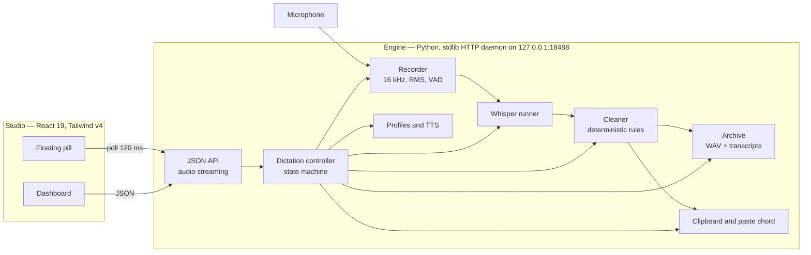
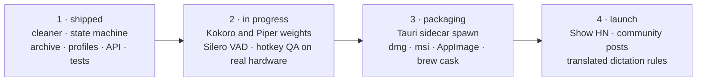

# OpenFlow

Local voice OS for macOS, Linux and Windows. Two workflows, one offline daemon:

- **Dictation** — hold a global shortcut, speak, release. The transcript is cleaned and
  inserted at the cursor of whatever app is focused.
- **Voice cloning** — record a 5–15 second reference once, then synthesize speech in that
  voice, offline.

No accounts, no API keys, no telemetry. Audio, transcripts, profiles and models live in
`~/.openflow`.

---

## Status

Beta, developed in the open. This table reflects the code in `main`, not a plan.

| Area | State | Notes |
| :--- | :--- | :--- |
| Dictation cleaner | Working | Fillers, stutters, spoken punctuation, casing, acronyms. Deterministic, idempotent, <1 ms. |
| Recording archive | Working | Raw 16 kHz WAV + raw transcript + cleaned transcript, searchable and exportable. |
| Voice profiles | Working | Browser capture, duration/loudness/clipping validation, pitch analysis. |
| Offline synthesis | Working, preview quality | Built-in formant vocoder matches your pitch and sentence rhythm; not intelligible speech. |
| Whisper transcription | Implemented | `faster-whisper`, falling back to `openai-whisper`. Not installed in CI, so CI runs in demo mode. |
| Global shortcuts, auto-paste | Implemented | Needs `pynput` plus a clipboard tool (`pbcopy`, `clip`, `wl-copy`, `xclip`). |
| Kokoro-82M / Piper voices | Partial | Backend probing exists; weight loading is not wired yet. |
| Silero VAD | Planned | Energy-based VAD ships today. |
| Tauri desktop shell | Scaffold | Window and tray config exist; it does not spawn the engine yet. |
| Non-English dictation | Planned | Cleaner rules are English-only. |

When no microphone or Whisper runtime is present, the engine starts in **demo mode**: captures
and transcripts are simulated, while the cleaner, archive, WAV handling and synthesis run for
real. The UI labels this, and every API response carries `demo: true`.

---

## Quick start

Requirements: Node.js 18+ and Python 3.10+.

```bash
git clone https://github.com/yashjaiswal2818/openflow.git
cd openflow

npm install
npm run dev
```

`npm run dev` starts the engine on `127.0.0.1:18488` and the Studio on `http://localhost:1420`.
The engine is optional: if Python is missing the Studio still loads and reports that it cannot
reach the daemon.

To enable real speech:

```bash
pip install -r requirements.txt
npm run dev
```

Detected capabilities are listed under **Settings → Diagnostics**.

Other commands:

```bash
npm run engine     # engine only
npm run dev:web    # Studio only (proxies /api to a running engine)
npm run build      # type-check and production bundle
npm test           # type-check plus engine tests
```

---

## Architecture



Three decisions worth knowing:

- **The cleaner is a rule engine, not a model** — no sampling, no drift, testable, fast enough
  to run on every transcript.
- **The engine core uses only the standard library.** `numpy`, `sounddevice`, `pynput` and
  Whisper are optional, so the daemon always starts and reports what is missing.
- **The browser never calls `localhost` directly.** The Studio uses relative `/api` paths and
  Vite proxies them, which keeps a single origin and avoids CORS.

---

## Dictation cleaner

```text
raw    uh basically i think that the the openflow engine is super fast
       comma new line ready for production period

clean  I think that the OpenFlow engine is super fast,
       Ready for production.
```

| Rule | Behaviour |
| :--- | :--- |
| Fillers | Removes `uh`, `um`, `erm`, "you know", "basically", hesitation "like". Keeps "I like apples". |
| Stutters | `the the` → `the`, `I I` → `I`, `th-the` → `the`. Keeps `no, no, no!` and `very, very good`. |
| Spoken punctuation | `comma` `period` `question mark` `exclamation point` `colon` `semicolon` |
| Structure | `new line` → newline, `new paragraph` → blank line |
| Casing | Sentence starts and the pronoun `I` |
| Acronyms | `api` → `API`, `json` → `JSON`, `macos` → `macOS`, `openflow` → `OpenFlow` |

Each pass returns counts per rule, which the Studio shows beside the raw/clean diff.

---

## Presets

| Preset | Speech-to-text | Text-to-speech | Target latency | Memory | Machine |
| :--- | :--- | :--- | :--- | :--- | :--- |
| Fast | `tiny.en` q5_1 | Piper VITS | <150 ms | <500 MB | any laptop, CPU only |
| Balanced | `small.en` q5_k | Kokoro-82M | <350 ms | ~1.5 GB | Apple Silicon, 8 GB |
| Pro Studio | `large-v3-turbo` | F5-TTS | high fidelity | ~4 GB | RTX GPU, 16 GB Mac |

Switching releases the previous Whisper model before loading the next, so memory does not
grow with use.

---

## API

JSON over `127.0.0.1:18488` (`OPENFLOW_HOST`, `OPENFLOW_PORT`, or `--host`/`--port`).

| Method | Path | Purpose |
| :--- | :--- | :--- |
| GET | `/api/health` | Liveness, version, data directory |
| GET | `/api/state` | Dictation state; `?light=1` omits capabilities, config and stats |
| GET | `/api/capabilities` | Detected hardware, models and injection backends |
| POST | `/api/dictation/start`, `/stop` | Record and process; `{"wait": true}` returns the result inline |
| POST | `/api/dictation/clean` | Run the cleaner on arbitrary text |
| GET | `/api/history` | Archive with `?q=` search and `?limit=` |
| POST | `/api/history/star`, DELETE `/api/history/{id}` | Curate entries |
| GET | `/api/history/export` | Markdown export |
| GET/POST/DELETE | `/api/profiles…` | List, enrol (base64 WAV), create demo profile, delete |
| POST | `/api/tts/synthesize`, `/api/read-aloud` | Synthesis, optionally played locally |
| GET | `/api/audio/{folder}/{file}` | WAV with HTTP range support |
| GET/PATCH | `/api/presets`, `/api/config/update` | Tiers and preferences; unknown keys rejected |

`/api/audio/*` serves only files inside the data directory; traversal attempts return `403`.

---

## Repository layout

```text
engine/                     Python engine (stdlib core)
  dictation_cleaner.py      Rule engine and per-rule report
  dictation_controller.py   ready → listening → processing → pasted state machine
  audio_recorder.py         16 kHz capture, RMS metering, energy VAD, demo capture
  whisper_engine.py         faster-whisper / whisper backends, preset handling
  voice_cloner.py           Profile validation, pitch analysis, TTS and preview vocoder
  history_manager.py        Atomic, thread-safe archive
  system_injector.py        Clipboard and native paste chord
  hotkey_daemon.py          Global push-to-talk and toggle shortcuts
  models_manager.py         Preset definitions and config persistence
  server.py                 ThreadingHTTPServer JSON API
src/                        Studio (React 19, TypeScript, Tailwind v4)
  components/               Pill, sidebar, header, waveform, player, tab views
  hooks/useEngine.ts        Adaptive polling and engine actions
  lib/api.ts                Typed client, origin-relative
  lib/recorder.ts           WebAudio to 16 kHz WAV, no ffmpeg
tests/                      unittest: cleaner, storage, audio, voices, HTTP API
scripts/dev.mjs             Runs engine and Vite together
src-tauri/                  Tauri v2 desktop shell (scaffold)
requirements.txt            Optional Python extras
.github/workflows/ci.yml    Python 3.10–3.12, Node 20/22
```

---

## Tests

```bash
npm test    # or: python3 -m unittest discover -s tests -t .
```

62 tests cover cleaner behaviour and idempotency, history storage, audio helpers and VAD,
voice profiles and synthesis, and the HTTP API (dictation cycle, range requests, path
traversal, config validation, error paths).

---

## Privacy

- The engine binds to loopback and only serves the local UI.
- No accounts, keys or telemetry.
- Everything persistent lives in one folder, `~/.openflow`; delete it and OpenFlow is gone.
- The UI loads no web fonts or external assets.

---

## Roadmap



Prior art that informed the architecture: [Handy](https://github.com/cjpais/Handy) for
cross-platform push-to-talk, [VoiceStudio](https://github.com/debpalash/VoiceStudio) for local
voice-cloning pipelines.

## Contributing

Run `npm run dev`, open the Dictation test bench and try to break the cleaner. Add the failing
case to `tests/test_dictation_cleaner.py`, then fix it. Rules must stay deterministic and
idempotent — `clean(clean(x)) == clean(x)` is enforced.

Bug reports are most useful with the OS, audio backend, and whether Whisper is installed
(**Settings → Copy JSON**).

## License

MIT. See [LICENSE](LICENSE).
